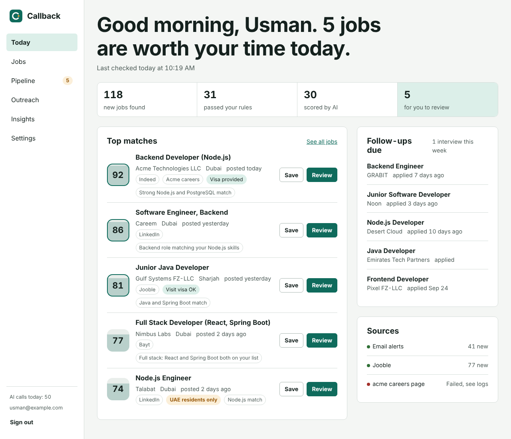
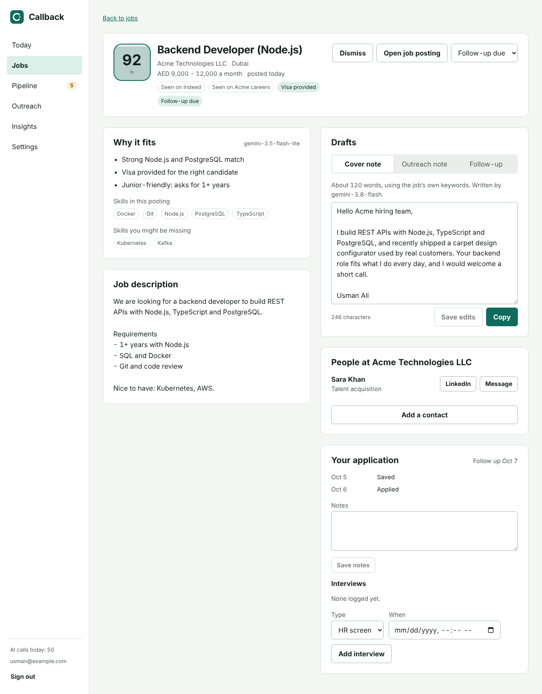
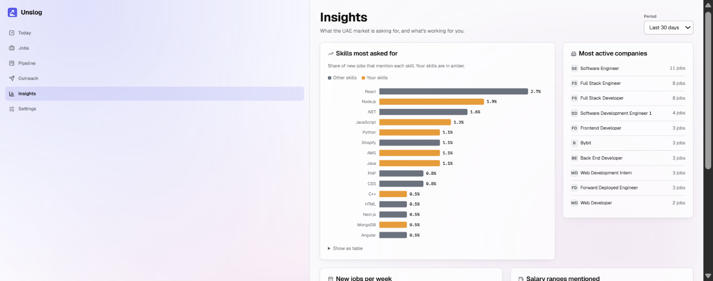

# Unslog

**A free job-hunt copilot for the UAE.** Every morning Unslog collects new jobs from your
job-alert emails, a job-search API and company careers pages, removes duplicates, filters them
against your profile, scores the best ones with a free AI model, drafts a cover note and a
LinkedIn note for each, and reminds you to follow up. You review and send everything yourself.



> Built for my own job search in Dubai, and designed so other people can use it too.
> Runs entirely on free tiers: GitHub Actions, Supabase, Vercel, Gemini and Groq.

## What it does

| Step | What happens | Where in the code |
| --- | --- | --- |
| Collect | Reads Indeed, LinkedIn, Bayt and Naukrigulf alert emails from Gmail, queries the Jooble API, and reads public job lists from company careers pages (Greenhouse, Lever, Ashby, Workable, SmartRecruiters) | `pipeline/src/collectors/` |
| Deduplicate | The same opening on three sites becomes one job with three sightings | `pipeline/src/stages/dedupe.ts` |
| Enrich | Tags skills, reads visa phrases ("UAE residents only"), minimum experience and AED salary | `pipeline/src/stages/enrich.ts` |
| Filter | Free rules: your cities, experience, blocked words, visa status | `pipeline/src/stages/prefilter.ts` |
| Score | Gemini (Groq as fallback) rates fit 0 to 100 with reasons, within free daily limits | `pipeline/src/stages/score.ts` |
| Draft | Cover note, outreach note and follow-up message for the top jobs | `pipeline/src/stages/draft.ts` |
| Remind | Applications quiet for 6+ days move to "Follow-up due" | `supabase/migrations/` (trigger) + `pipeline/src/run.ts` |
| Digest | A morning message on Telegram or email | `pipeline/src/stages/digest.ts` |
| Dashboard | Today, Jobs, Job detail, Pipeline, Outreach, Insights, Settings | `web/src/pages/` |

Without any AI key it still works: jobs get a free heuristic score and drafts come from templates.

## Tech stack

- **Pipeline:** Node.js 22 + TypeScript, plain SQL with `pg`, Zod for validation, htmlparser2 for emails
- **Database and auth:** Supabase (Postgres, Row Level Security, Google sign-in)
- **AI:** Gemini API free tier (Flash / Flash-Lite), Groq free tier as fallback
- **Dashboard:** React 19 + Vite, hosted on Vercel
- **Scheduling and CI:** GitHub Actions (daily run at 08:00 Dubai time, tests on every push)

## Quick start

```bash
git clone https://github.com/<you>/unslog.git && cd unslog
npm install
cp .env.example .env            # fill in DATABASE_URL and the Supabase keys at least
npm run db:migrate              # creates the tables in your Supabase project
npm run dev                     # dashboard on http://localhost:5173
npm run pipeline -- run         # one full pipeline run
```

The full walkthrough, including Gmail, Jooble, Telegram and deployment, is in
[docs/01-getting-started.md](docs/01-getting-started.md).

## Documentation

| Doc | What's in it |
| --- | --- |
| [Local setup and GitHub](docs/00-local-setup-and-github.md) | Tools, install, first commit and push |
| [Getting started](docs/01-getting-started.md) | Accounts, keys, first run, deploy |
| [Architecture](docs/02-architecture.md) | Components, folder layout, how data flows |
| [Data model](docs/03-data-model.md) | Every table, how they link, why |
| [Pipeline](docs/04-pipeline.md) | Each stage in detail, adding a source, tuning email parsers |
| [System design concepts](docs/05-system-design.md) | The concepts used, mapped to the code |
| [AI](docs/06-ai.md) | Providers, prompts, quotas, prompt-injection defence |
| [Frontend](docs/07-frontend.md) | Pages, data access, design tokens |
| [Security and privacy](docs/08-security-and-privacy.md) | Secrets, RLS, what data goes where |
| [Testing](docs/09-testing.md) | What is tested and how to run it |
| [Deployment](docs/10-deployment.md) | GitHub Actions, Vercel, Supabase in production |
| [Learning guide](docs/11-learning-guide.md) | What to study in each part, interview talking points |
| [Roadmap](docs/12-roadmap.md) | What's next, including the Spring Boot rewrite |
| [Decision records](docs/adr/) | Why things are built the way they are |

## Screens

| Job detail | Insights |
| --- | --- |
|  |  |

Screens show sample data.

## Responsible use

Unslog reads job-alert emails that sites send you, uses Jooble's official API, and reads
job lists that companies publish for anyone to read. It does not scrape job boards, log in to
your accounts or apply on your behalf. Read each source's terms before adding new ones.

## License

[MIT](LICENSE)
