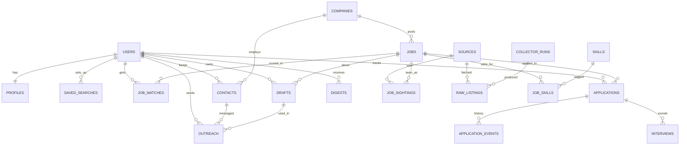

# Data model

The schema lives in [`supabase/migrations/20261008000000_init.sql`](../supabase/migrations/20261008000000_init.sql).
20 entities in two groups:

- **Shared job data.** Written only by the pipeline, readable by every signed-in user.
- **Per-user data.** Every row has `user_id`, and Row Level Security limits each user to their
  own rows. This is what makes multi-user possible without a redesign.

## Shared job data

| Table | One row is | Key columns | Notes |
| --- | --- | --- | --- |
| `sources` | A place jobs come from | `key` (unique, e.g. `gmail:indeed`, `jooble`, `ats:lever:acme`), `kind`, `last_success_at`, `last_error` | Upserted by collectors each run |
| `collector_runs` | One run of one collector | `collector`, `status`, `found`, `new_count`, `error` | Powers the Sources health card; debugging |
| `raw_listings` | A job exactly as a source sent it | `payload` (JSON), unique `(source_id, external_id)` | Lets you fix a parser and re-process without re-fetching. Never readable from the browser |
| `companies` | An employer | `normalized_name` (unique) | "Acme L.L.C." and "ACME LLC" become one company |
| `jobs` | One real opening, deduplicated | `fingerprint` (unique), `title`, `city`, `description`, `description_is_full`, `salary_min_aed`/`max`, `experience_min`, `visa_flags[]` | A full description replaces a snippet, never the reverse |
| `job_sightings` | Where and when a job was seen | unique `(job_id, source_id)`, `url` | One job on three sites = one `jobs` row + three sightings |
| `skills` | A dictionary entry | `name`, `aliases[]`, `category` | Seeded with ~85 skills; add your own |
| `job_skills` | A skill a job asks for | PK `(job_id, skill_id)` | Feeds "Skills most asked for" |
| `ai_usage` | AI calls per day per provider/model/purpose | PK `(day, provider, model, purpose)`, `requests`, `failures`, tokens | Keeps the pipeline inside free-tier limits |

## Per-user data

| Table | One row is | Key columns | Notes |
| --- | --- | --- | --- |
| `auth.users` | An account (Supabase) | `id`, `email` | Managed by Supabase Auth |
| `profiles` | What the pipeline matches against | `skills[]`, `years_experience`, `target_titles[]`, `cities[]`, `visa_status`, `must_have[]`, `blocked_words[]`, `min_score`, `max_ai_jobs_per_day`, `follow_up_days`, `target_companies` (JSON), digest settings | 1:1 with the user |
| `saved_searches` | A keyword search for Jooble | `keywords`, `location` | Optional; target titles are used otherwise |
| `job_matches` | How well one job fits one user | unique `(user_id, job_id)`, `prefilter_passed`, `prefilter_reason`, `quick_score`, `score`, `reasons` (JSON), `missing_skills[]`, `model`, `dismissed_at` | Per user, because the same job fits people differently. Users can only change `dismissed_at` |
| `drafts` | Text written for you | unique `(user_id, job_id, type)`, `type` (cover_note / outreach / follow_up), `content`, `edited_by_user` | The pipeline never overwrites a draft you edited |
| `applications` | A job you're pursuing | unique `(user_id, job_id)`, `status`, `channel`, `applied_at`, `next_follow_up_at` | Status: saved → applied → follow_up_due → interview → offer, or rejected / withdrawn |
| `application_events` | One status change | `from_status`, `to_status`, `at` | Append-only, written by a trigger; users can read but not write |
| `interviews` | One interview round | `round`, `type`, `scheduled_at`, `outcome` | |
| `contacts` | A person at a company | `name`, `role`, `linkedin_url`, `company_id` | Only work details people share publicly |
| `outreach` | A message you sent | `channel`, `status` (sent / replied / no_reply), `sent_at`, `replied_at` | Powers reply-rate insights |
| `digests` | A morning digest that was sent | `channel`, `job_ids[]`, `ok`, `error` | Also stops a second digest the same day |

## Triggers

- `applications_track_status` (before insert/update): when status becomes `applied`, stamps
  `applied_at` and sets `next_follow_up_at = applied_at + follow_up_days`. Interview, offer,
  rejected or withdrawn clear the follow-up date.
- `applications_log_event` (after insert/update): appends an `application_events` row for every
  status change. It runs as the table owner, so users can't forge history.
- `set_updated_at` on `profiles` and `drafts`.

## Dashboard functions

SQL functions the dashboard calls with `supabase.rpc(...)`. They run as the caller, so RLS
still applies: `today_summary()`, `insights_top_skills(days, lim)`, `insights_top_companies`,
`insights_jobs_per_week`, `insights_salary_by_title`, `insights_funnel()`,
`insights_reply_by_channel()`. `ai_usage_today()` returns only aggregate counts.

## Indexes worth knowing

- `jobs.fingerprint` unique: the deduplication key, and what makes upserts idempotent.
- `job_matches (user_id, score desc)`: the Today and Jobs lists.
- `applications (user_id, status, next_follow_up_at)`: finding follow-ups due.
- `raw_listings (source_id, external_id)` unique: refetching the same listing updates, never duplicates.

## Design choices

- **`jobs` vs `job_sightings`** separates *what* a job is from *where* it was seen.
- **Scores on `job_matches`, not `jobs`**: scores are personal.
- **Current status on `applications`, history in `application_events`**: fast queries for "now",
  a full audit trail for the funnel.
- **`raw_listings`**: parsers will be wrong sometimes; keeping the input makes that cheap to fix.
- **Enums for statuses**: the database rejects typos like `aplied`.
