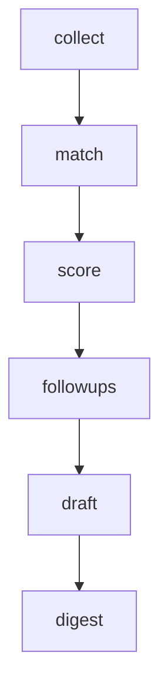

# The pipeline

`npm run pipeline -- run` runs six steps in order. Each step can also run on its own:
`npm run pipeline -- run --steps match,score`.



Every collector and every per-user stage is isolated: one failure is logged, recorded and
skipped, and the rest of the run continues. The process exits with code 1 only when every
collector that ran failed, so GitHub emails you about real outages, not one flaky source.

## 1. collect

Code: `pipeline/src/run.ts` (`runCollector`, `ingest`), `pipeline/src/collectors/`.

For each configured collector:

1. A `collector_runs` row is opened.
2. The collector returns `RawJob[]` plus the `sources` it covers.
3. Each raw job is stored in `raw_listings` (upsert on source + external id), then **normalized**
   (`stages/normalize.ts`): whitespace cleaned, city detected (`lib/uae.ts`), salary, experience
   and visa phrases parsed (`stages/enrich.ts`), and the **fingerprint** computed (`stages/dedupe.ts`).
4. The company is upserted, the job is upserted on its fingerprint, a sighting is added, and
   skills are tagged from the dictionary.
5. The run row is closed with `found`, `new_count` and any error.

### The collectors

| Collector | Name in runs | Needs | Notes |
| --- | --- | --- | --- |
| `GmailCollector` | `gmail` | `GMAIL_*` | Searches `from:(indeed.com OR linkedin.com OR bayt.com OR naukrigulf.com) newer_than:3d` |
| `JoobleCollector` | `jooble` | `JOOBLE_API_KEY` | One POST per search per page (`JOOBLE_PAGES`, default 2) |
| `AtsCollector` | `ats:<ats>:<slug>` | a target company in Settings | One per company board, so one broken board never hides the others. Only UAE locations are kept |

All HTTP goes through `lib/http.ts`: timeouts, retries with exponential backoff on 429/5xx,
`Retry-After` honoured, keys redacted from logs. `Throttle` keeps a gap between requests to the
same host (`HTTP_DELAY_MS`, default 1.5 s).

### Adding a source

1. Create a class that implements `Collector` (`collectors/types.ts`):

   ```ts
   export class MyBoardCollector implements Collector {
     readonly name = 'myboard';
     isConfigured() { return Boolean(this.config.MYBOARD_KEY); }
     async collect() {
       const jobs: RawJob[] = /* fetch and map */ [];
       return { jobs, sources: [{ key: 'myboard', name: 'My Board', kind: 'api' }] };
     }
   }
   ```

2. Register it in `collectors/index.ts`.
3. Add a mapper test in `test/collectors.test.ts` with a sample payload.

Nothing else changes: deduplication, scoring and the dashboard work for the new source.

### Tuning the email parsers

Alert emails change layout without notice. The parser (`collectors/gmail/parsers.ts`) avoids
per-site CSS selectors and uses one strategy for all sites:

1. Find links whose URL matches the site's job-link pattern (`SITE_RULES[].jobLink`).
2. Canonicalize each link to a stable id (`canonical()`): Indeed's `jk`, LinkedIn's
   `/jobs/view/<id>`, the numeric id at the end of Bayt and Naukrigulf URLs. Logo links and
   "View job" buttons point to the same id, so they merge.
3. Use the link text as the title (skipping buttons like "View job"), and read company and
   location from the lines that follow, inside the smallest block around the link.
4. Plain-text emails: a URL on its own line, with the title on the line above.

When a site's jobs stop appearing:

1. `npm run gmail:sample` saves recent alert emails to `pipeline/test/fixtures/private/` and
   prints what was found in each.
2. Open the email with no jobs and check the job links. Usually the URL pattern changed: update
   `jobLink` and `canonical()` for that site.
3. Copy the email into a new fixture with personal details removed, add a test in
   `test/parsers.test.ts`, and run `npm test`.

## 2. match

Code: `run.ts` (`matchUser`), `stages/prefilter.ts`.

For every user and every job from the last 30 days that has no `job_matches` row yet, the free
pre-filter decides pass or fail and writes the reason:

| Rule | Fails when |
| --- | --- |
| Blocked words | The posting contains any of your blocked phrases |
| City | The job's city is known and not one of yours |
| Experience | It asks for more than your years + 2 |
| Visa | You're on a visit visa and it says UAE residents only |
| Must-have | You set must-have words and it mentions none of them |

Passing jobs get a **quick score** (0–100): skill overlap (up to 55), target-title match (25),
freshness (15) and a small bonus when the posting welcomes visit-visa holders or provides a visa.

Your profile skills are first mapped onto the dictionary, so "node" in your profile matches
"Node.js" in jobs.

## 3. score

Code: `stages/score.ts`, `ai/`.

Takes up to `max_ai_jobs_per_day` (minus what was already scored today) of the best quick-scored
jobs from the last 14 days and asks the AI router for a JSON score. The router tries Gemini, then
Groq, validates the JSON with Zod, and records usage in `ai_usage`. See [AI](06-ai.md).

Jobs beyond the budget, or all jobs when no AI is available, get the quick score with
`model = 'heuristic'`. A heuristic-scored job comes back on later days, so AI can score it once
budget is available.

## 4. followups

Applications in `applied` whose `next_follow_up_at` has passed move to `follow_up_due`. The
follow-up date is set by a database trigger: when you mark a job as applied, it's
`applied_at + follow_up_days`. After you nudge them and click **I followed up** (status back to
Applied), the next check-in counts from that day, and each new cycle gets a fresh follow-up draft.

## 5. draft

Code: `stages/draft.ts`.

For your top `DRAFT_TOP_N` jobs (score ≥ your `min_score`, not dismissed, not applied yet, no
draft yet): a cover note and a LinkedIn outreach note. For applications in `follow_up_due`: a
follow-up message. Without AI, template drafts are written instead (`model = 'template'`).
Drafts you edited are never overwritten.

## 6. digest

Code: `stages/digest.ts`.

Once per day per user, on the channel chosen in Settings (Telegram or email): the top jobs from
the last day that you haven't acted on, plus follow-ups due, with links into the dashboard. All
text is HTML-escaped.

## Configuration reference

All settings are environment variables (see `.env.example`). Per-user settings live in the
profile and are edited in the dashboard.

| Variable | Default | Meaning |
| --- | --- | --- |
| `DATABASE_URL` | (required) | Postgres connection string |
| `APP_URL` | `http://localhost:5173` | Dashboard URL for digest links |
| `GEMINI_API_KEY` / `GROQ_API_KEY` | (none) | AI providers; both optional |
| `GEMINI_SCORE_MODEL` | `gemini-3.5-flash-lite` | Model for scoring |
| `GEMINI_DRAFT_MODEL` | `gemini-3.8-flash` | Model for drafts |
| `GEMINI_DAILY_LIMIT` / `GROQ_DAILY_LIMIT` | 200 / 500 | Requests per day we allow ourselves |
| `GEMINI_MIN_INTERVAL_MS` / `GROQ_MIN_INTERVAL_MS` | 4500 / 2500 | Gap between calls (requests-per-minute limits) |
| `GROQ_MODEL` | `llama-3.3-70b-versatile` | Fallback model |
| `JOOBLE_API_KEY`, `JOOBLE_HOST`, `JOOBLE_PAGES` | –, `jooble.org`, 2 | Jooble |
| `GMAIL_CLIENT_ID` / `_SECRET` / `_REFRESH_TOKEN` | (none) | Gmail OAuth |
| `GMAIL_QUERY_DAYS` | 3 | How far back to look for alert emails |
| `TELEGRAM_BOT_TOKEN` | (none) | Telegram digest |
| `DRAFT_TOP_N` / `DIGEST_TOP_N` | 10 / 10 | How many jobs get drafts / appear in the digest |
| `HTTP_DELAY_MS` | 1500 | Politeness gap between requests to a host |
| `ALLOWED_USER_IDS` | (everyone) | Comma-separated user ids the pipeline serves |
| `SHARED_AI_MAX_JOBS_PER_USER_PER_DAY` | 20 | Per-user cap on AI calls against the shared key (BYOK users aren't capped by this) |
| `LOG_LEVEL` | `info` | `debug`, `info`, `warn`, `error`, `silent` |
